## 1. Project Overview

| Field | Value |
|-------|-------|
| **Studio** | Pixel Verse Studios |
| **Project Type** | Game studio: two desktop games and a studio website |
| **Products** | **Crab Quest** (6-chapter ocean platformer) and **Space X: Journey to Jupiter** (4-level space adventure) |
| **Description** | Pixel Verse Studios is a small indie studio that makes 16-bit narrative games for children. In each game the player learns real science without a lecture: ocean life and ocean conservation in Crab Quest, the solar system in Space X. |
| **Target Age Group** | 5-99 years old |
| **Team** | Mariam Alaa, Selim Loai, Mohamed Loai, Medhat Ali, Salah Mohamed |
| **Competition** | AFFIAT · Afro-Asian Forum for Innovation and Technology · Aswan Finals 2026, Games category |

### The two games

| | Crab Quest | Space X: Journey to Jupiter |
|---|---|---|
| **Genre** | Platformer, survival and collection in one story | Walk-and-collect, dodge and shoot |
| **Story** | A crab escapes a kitchen and journeys home through 6 chapters | A Hero flies from Earth to Jupiter's moon Europa to find out if its hidden ocean could hold life |
| **Structure** | 6 chapters picked from a level-select screen | 4 levels played in order, then a win screen |
| **Window** | 1200 × 600 | 800 × 600 |
| **What you learn** | Marine life, pollution and predators, coral sanctuaries | Rockets, space junk, the asteroid belt, Europa's ocean, Jupiter, and a fact about the Sun or a planet after every loss |

### Tech Stack

| Category | Technology | Purpose |
|----------|-----------|---------|
| **Language** | Python 3.11+ | All game logic |
| **Game engine** | Pygame Zero (`pgzero` 1.2.1) on Pygame 2.6.1 | Window, `Actor` sprites, keyboard, mouse, music |
| **Website** | Plain HTML + one hand-written CSS file + a small JavaScript file | The studio's public page about both games |
| **Art** | 16-bit pixel art (AI-assisted, cleaned by the team) | Backgrounds, sprites, planets |
| **Font** | Jersey 10 (SIL Open Font License) | Pixel text inside Space X |
| **Packaging** | PyInstaller (Windows) and itch.io | Planned release path |
| **Source control** | One Git repository holding all three projects | Shared history and issues |

---

## 2. Problem Statement

Facts in school can feel far away from play. A child who is told that Europa hides an ocean, or that plastic hurts sea turtles, hears a sentence. A child who has to *dodge* that plastic, or *fly through* Europa's ice, remembers an experience.

### What problem does this project solve?

The studio turns science facts into game moments, so learning does not need a separate lesson. Every level has a reason to exist in the story, and every fact shows up exactly where it makes sense in the game.

### Why does it matter?

Children already spend time on games. Games that teach honestly, with real facts and no fake features, give that time a purpose. Pixel art and short sessions keep the games light enough to run on any school computer.

### How is it solved?

- **Crab Quest** carries a conservation story: the crab dodges real threats (birds, trash, predators), helps a shrimp, and ends in a protected coral sanctuary.
- **Space X** carries a science mission: each level ends on a *Fact card* with a story line and one real fact, and every game over shows a picture and a fact about a planet.

---

## 3. Technical Architecture

The studio keeps both games and the website in one repository. Each project keeps its own folder, its own `ISSUES.md` and its own instructions.

```text
PVS/
├── Crab-game/              Crab Quest (Pygame Zero)
│   ├── main.py             the only entry point: hooks for draw/update/input
│   ├── game_states.py      shared state: game_mode, music, game over, win
│   ├── start_screen.py, level_select.py
│   ├── level_1.py ... level_6.py    one self-contained module per chapter
│   ├── images/, music/
├── space-game/             Space X: Journey to Jupiter (Pygame Zero)
│   ├── Game.py             only the Pygame Zero hooks, switches on the mode
│   ├── screens/            title, fact card, game over, win
│   ├── levels/             launch_pad, earth_orbit, belt, europa
│   ├── parts/              ship, controls, hud, shared game state
│   ├── data/               level targets, story lines, planet facts
│   ├── images/, music/, fonts/
├── pixel-verse-studios/    studio website (HTML + CSS)
└── docs/                   this documentation, the poster and the slides
```

### Architecture and Data Flow

Both games use the same idea: a **mode switch**. One shared variable says which screen is showing, and each Pygame Zero hook (`draw`, `update`, key and mouse events) hands the work to the module that owns that screen.

```text
 Keyboard / mouse
        │
        ▼
 ┌───────────────┐   reads mode    ┌─────────────────────────┐
 │ Pygame Zero   │ ──────────────► │ screen or level module  │
 │ draw / update │ ◄────────────── │ draws, moves, scores    │
 └───────────────┘   changes mode  └───────────┬─────────────┘
                                               │ reads
                                               ▼
                               images/  music/  data (facts, targets)
```

### Key Files

| File | Purpose |
|------|---------|
| `Crab-game/main.py` | Entry point. Switches on `game_states.game_mode` (`START_SCREEN`, `LEVEL_SELECT`, `LEVEL1` ... `LEVEL6`) and draws the global mute button |
| `Crab-game/game_states.py` | Shared state. A module changes screen by assigning `game_mode` |
| `Crab-game/level_N.py` | One chapter: its own sprites, platforms, physics constants and `reset()` |
| `space-game/Game.py` | Pygame Zero hooks and `start_level()`; switches on `game_states.mode` (`TITLE`, `PLAYING`, `FACT_CARD`, `GAME_OVER`, `WIN`) |
| `space-game/levels/*.py` | One module per level; each decides when it is cleared |
| `space-game/data/level_data.py` | One number per level (points target), the story line and the fact on each Fact card |
| `space-game/data/game_data.py` | The planet facts shown at game over: image plus lines of text |
| `pixel-verse-studios/index.html` etc. | The four pages of the studio website |
| `pixel-verse-studios/scripts/check_site.py` | Acceptance check for the website |

---

## 4. Features & User Flow

### Feature List

| # | Feature | Game | Status |
|---|---------|------|:------:|
| 1 | Six chapters with different mechanics (platforming, dodging, collecting, surviving) | Crab Quest | ✅ |
| 2 | Level-select screen and mute button | Crab Quest | ✅ |
| 3 | Walkable launch pad with a 30-second countdown and a four-item checklist | Space X | ✅ |
| 4 | Dodge space junk in Earth orbit | Space X | ✅ |
| 5 | Shoot asteroids in the belt; the Ship fires on its own | Space X | ✅ |
| 6 | Two-hit ice chunks on Europa, then an automatic 3-second scan | Space X | ✅ |
| 7 | Fact card after every level | Space X | ✅ |
| 8 | Planet picture and fact at every game over | Space X | ✅ |
| 9 | Win screen on Jupiter, high score kept during the session | Space X | ✅ |
| 10 | Clickable on-screen buttons next to the keyboard controls | Space X | ✅ |
| 11 | Windows download and itch.io page | Both | ⏳ |

> Status: ✅ Complete | ⏳ In Progress | ❌ Not Started

### Controls

| Input | Crab Quest | Space X |
|-------|-----------|---------|
| ← → (or A D) | Move | Move the Hero or the Ship |
| SPACE | Jump | Start, continue, and shoot in the belt and on Europa |
| P | | Pause |
| R | Restart | Retry the level / fly again |
| ENTER | Back to level select | |
| F | | Fullscreen |
| Mouse | Choose a level, mute | Choose on menus, on-screen left, right and pause buttons |

### User Flow

```text
 Crab Quest
   START ─► LEVEL SELECT ─► chapter 1-6 ─► (win or lose) ─► LEVEL SELECT

 Space X
   TITLE ─► L1 Launch pad ─► L2 Earth orbit ─► L3 Asteroid belt ─► L4 Europa ─► WIN
                 each level cleared ─► FACT CARD ─► next level
                 all hearts lost    ─► GAME OVER (planet fact) ─► same level again
```

### Screen Reference

| Screen | Game | Description | Transitions To |
|--------|------|-------------|----------------|
| Start | Crab Quest | Title, animated fish, start button | Level select |
| Level select | Crab Quest | Six chapter buttons | Any chapter |
| Chapters 1-6 | Crab Quest | See section 5 | Level select / start screen |
| Title | Space X | Logo, Hero, mission text, high score | Launch pad |
| Launch pad | Space X | Collect 4 items before the countdown ends, then board | Fact card |
| Earth orbit, Asteroid belt, Europa | Space X | Flying levels with hearts and a points target | Fact card or Game over |
| Fact card | Space X | Story line (cyan) and a science fact (white) | Next level |
| Game over | Space X | Random planet picture and fact | Same level again |
| Win | Space X | Jupiter, mission complete, fact | Title |

---

## 5. Level Design

### Crab Quest: six chapters

| # | Chapter | Type | What to do | Win | Lose |
|---|---------|------|-----------|-----|------|
| 1 | Kitchen Escape | Platformer | Jump across 7 counter platforms | Reach the goal at the top right | None (retry any time) |
| 2 | Beach Run | Survival | Dodge falling birds | Survive 30 s, then reach the ocean wave | Bird collision |
| 3 | Sea Floor Dodging | Survival | Dodge falling trash | Survive 10 s, then follow the turtle | Trash collision |
| 4 | Shrimp Help | Platformer, collection | Gather algae food as the shrimp | Collect all 17 items in 60 s | Timer runs out |
| 5 | Predator Chase | Survival | Avoid patrolling evil fish | Survive 45 s | Fish collision |
| 6 | Home Sweet Home | Platformer | Reach the crab family | Reach the family | None (final level) |

### Space X: four levels

| # | Level | What to do | Ends when | Lose |
|---|-------|-----------|-----------|------|
| 1 | Launch pad | Walk the Hero, collect helmet, ammo crate, lucky football and fuel can, then board the Ship | All 4 items collected, Hero boards, Ship blasts off | The 30-second countdown reaches 0 |
| 2 | Earth orbit | Dodge space junk (the Ship cannot shoot) | 10 pieces dodged | Lose all 3 hearts |
| 3 | Asteroid belt | Shoot asteroids; the Ship fires every half second | 30 asteroids shot | Lose all 3 hearts |
| 4 | Europa | Break the ice (2 hits each); then a 3-second scan | 12 ice chunks broken | Lose all 3 hearts |

Winning level 4 flies the Hero to Jupiter and shows the win screen with the score and the session high score.

---

## 6. UI/UX Design

Both games use 16-bit pixel art with hard-edged pixels and a dark outline on every object. Light comes from the upper left. The website uses the same dark, neon "arcade" mood.

### Screenshots

**Space X** (captured from the running game):

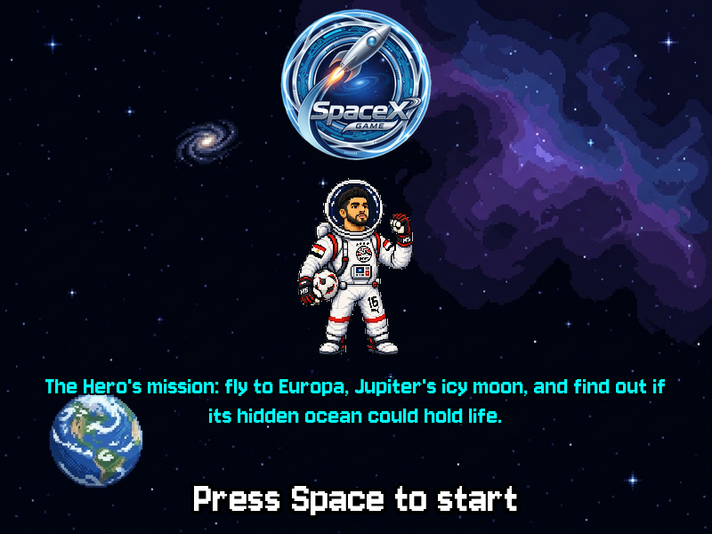{.shot} 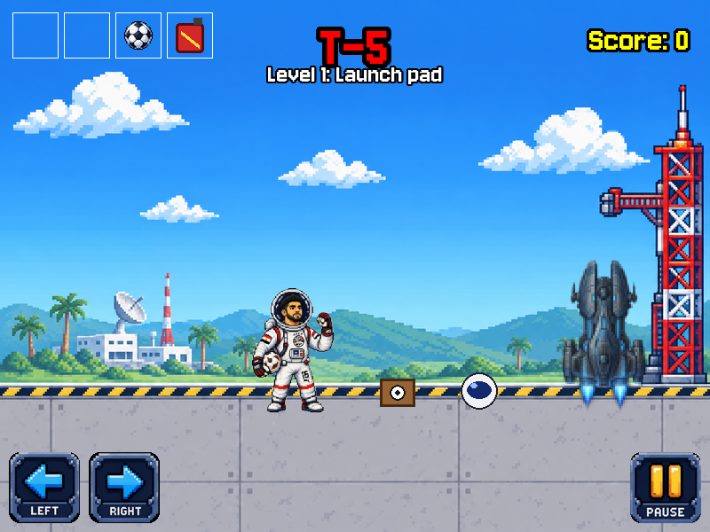{.shot}

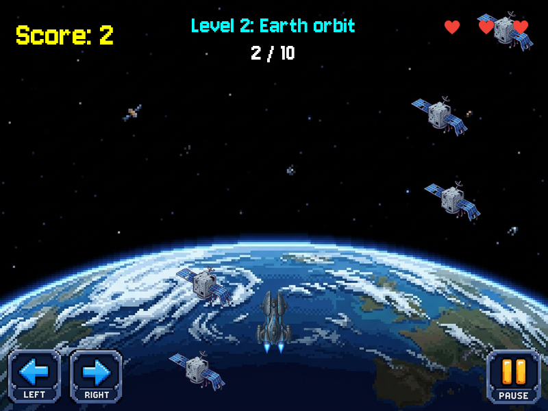{.shot} 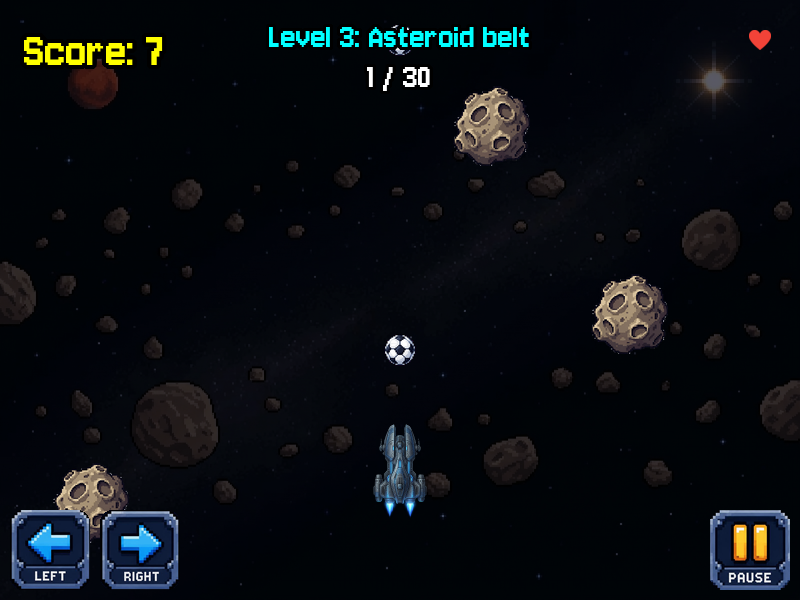{.shot}

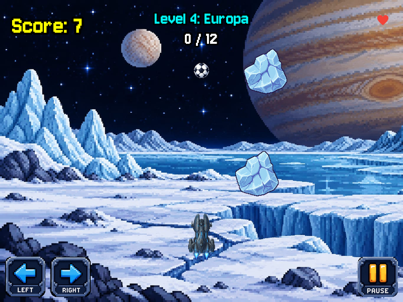{.shot} 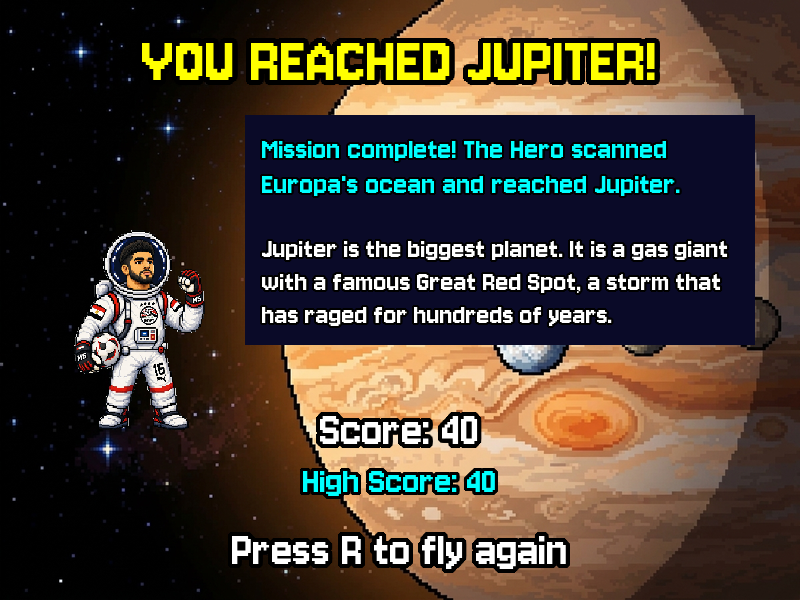{.shot}

**Crab Quest:**

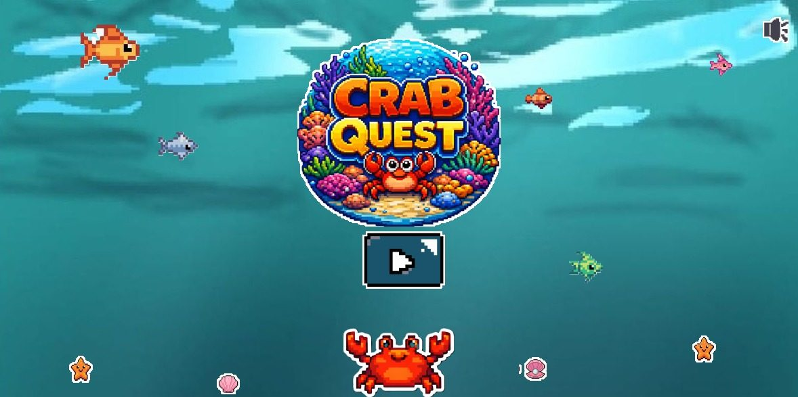{.shot} 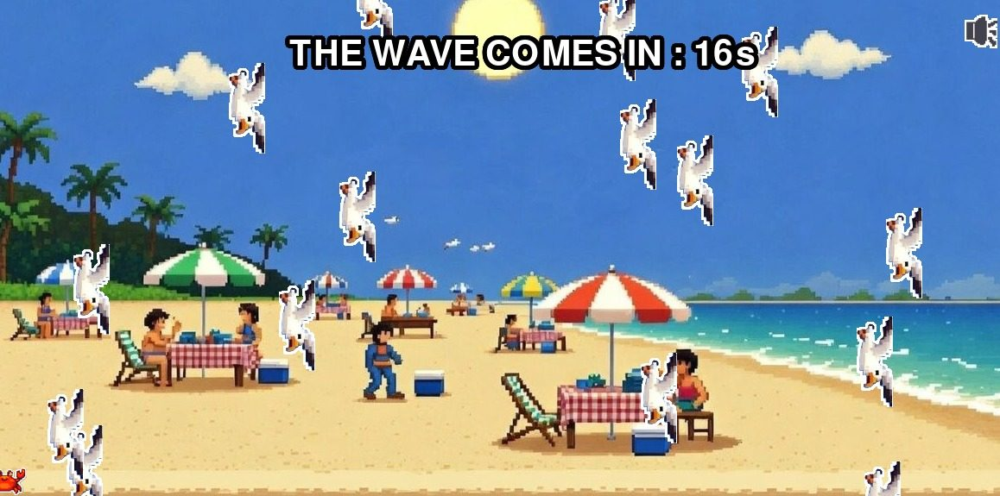{.shot}

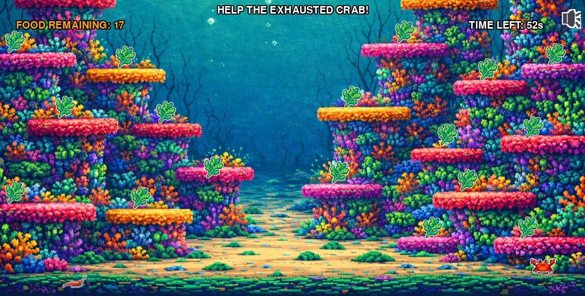{.shot} 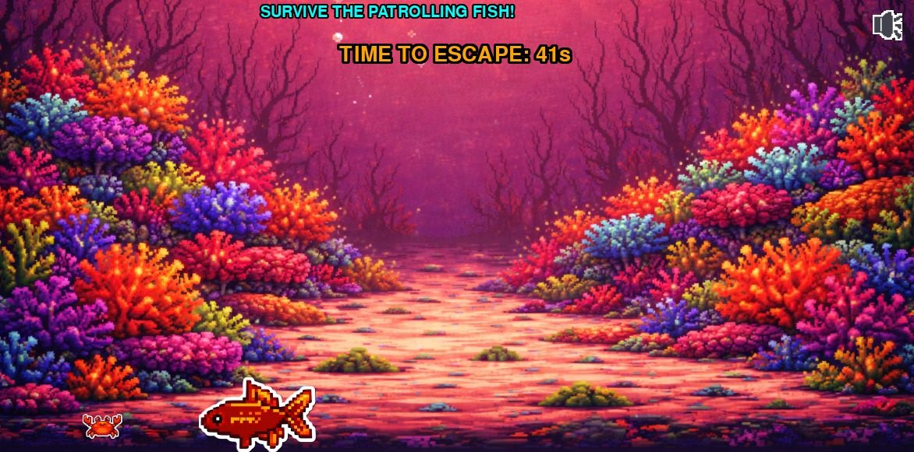{.shot}

### Design System

| Element | Style |
|---------|-------|
| **Page background** | #0F131C (website), deep navy and black space (Space X) |
| **Accent colors** | Purple #D0BCFF, cyan #4CD7F6, green #4EDEA3 |
| **Fonts** | Space Grotesk (headings) and Inter (body) on the website; Jersey 10 pixel font in Space X |
| **Buttons** | Square corners with a hard offset shadow; pixel arrows in Space X |
| **Layout** | Full-width sections with cards on the website; one 800 × 600 or 1200 × 600 window per game |

### Responsive Design

| Breakpoint | Layout | Tested? |
|------------|--------|:-------:|
| Games: fixed windows (800 × 600, 1200 × 600) | Desktop only; Space X also supports fullscreen with F | ✅ |
| Website: desktop | Full-width sections, card grids | ✅ |
| Website: tablet and mobile | Cards stack in one column | ☐ |

---

## 7. Asset Inventory

### Space X

| Category | Files | Folder |
|----------|-------|--------|
| Backgrounds | 6: launch pad, Earth, belt, Europa, Jupiter, title | `images/backgrounds/` |
| Characters | Hero, small Hero (2 directions), Ship, Ship on the pad | `images/characters/` |
| Sprites | asteroid, space junk, ice, cracked ice, football | `images/sprites/` |
| Checklist items | helmet, ammo crate, football, fuel can | `images/items/` |
| Interface | left, right, pause, continue, heart, logo | `images/ui/` |
| Planet pictures | the Sun and 8 planets, plus the Moon and an asteroid | `images/planets/` |
| Audio | background music, crash sound, shoot sound | `music/` |
| Font | Jersey 10 (SIL Open Font License) | `fonts/` |

### Crab Quest

| Category | Count |
|----------|------:|
| Backgrounds | 7 |
| Characters (crab, shrimp) | 3 |
| UI elements | 5 |
| Fish and enemies | 9 |
| Environment | 5 |
| Hazards | 5 |
| Collectibles and platforms | 3 |
| Music tracks | 1 |
| **Total** | **38** |

---

## 8. Data Sources

All content is stored inside the projects. There are no online services, accounts or databases.

| Source | Type | Description |
|--------|------|-------------|
| `space-game/data/game_data.py` | Python list | Nine entries (the Sun and the eight planets): an image path and the lines of text for each fact |
| `space-game/data/level_data.py` | Python list | For each of the four levels: name, background, points target, story lines and fact |
| `images/`, `music/`, `fonts/` | Local files | Sprites, backgrounds, planet pictures, music, sound effects, pixel font |
| `game_states` modules | In-memory state | Current screen, health, score; the Space X high score resets when the game closes |

### External APIs

| API | Purpose | Rate Limit |
|-----|---------|------------|
| None | Everything runs offline | N/A |

---

## 9. Educational Content

### Learning Objectives

By playing, a student will:

1. Learn that ocean animals face real threats: predators, trash and lost homes (Crab Quest)
2. See why protected areas such as coral sanctuaries matter (Crab Quest chapter 6)
3. Learn why rockets carry their own oxygen, and that Earth's orbit is crowded with old satellites (Space X)
4. Learn that the asteroid belt lies between Mars and Jupiter and that ships can fly through it safely (Space X)
5. Learn that Europa hides a salty ocean under its ice, and that Jupiter is a gas giant with a Great Red Spot (Space X)
6. Meet the Sun and all eight planets through the game-over facts (Space X)

### Cultural / Historical Context

| Topic | Description |
|-------|-------------|
| Marine life | Crabs, shrimp, sea turtles, fish and coral reefs, and how they live together |
| Ocean conservation | Pollution in chapter 3, predators in chapter 5, a sanctuary in chapter 6 |
| Space exploration | Launches, orbit, the asteroid belt and the search for life on Europa |
| The solar system | Facts about the Sun and each planet |

### Curriculum Alignment

| Skill Area | What the Student Practices |
|------------|---------------------------|
| Science | Ocean ecosystems, the solar system, conservation |
| Problem Solving | Timing jumps, dodging, planning a route through a level |
| Computational Thinking | State machines, spawn timers, collision rules, difficulty targets |
| Creativity | Pixel art, level layout, storytelling |
| Collaboration | A five-person team sharing one repository |

---

## 10. Marketing Plan

> **Short version** — for full marketing plans, use the main Afro-Asian template.

### Target Audience

- **Primary**: Children and families who want a short, friendly game that teaches something real
- **Secondary**: Teachers looking for science-integrated games for the classroom or the computer lab
- **Tertiary**: Indie-game fans and AFFIAT visitors

### Platforms

- Windows desktop, from a PyInstaller build (in progress)
- itch.io studio page with both games and a source download (planned)
- The studio website, which describes both games

### Promotion Ideas

1. Present at the AFFIAT Aswan Finals 2026 with the poster and a live demo
2. Publish both games on itch.io with screenshots, controls and downloads
3. Run a classroom session where students play and then answer "what did you learn?"
4. Share gameplay screenshots and short clips from the real games

---

## 11. Team Worksheet

### Our Studio Information

**Studio**: Pixel Verse Studios

**Games**: Crab Quest, Space X: Journey to Jupiter

**Date**: 2026

#### The team

| Member | Portrait |
|--------|----------|
| Mariam Alaa | 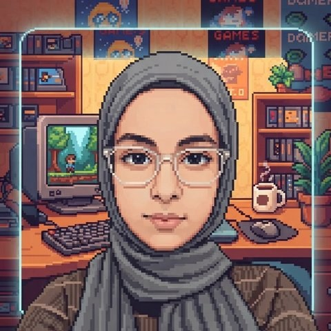{.avatar} |
| Selim Loai | 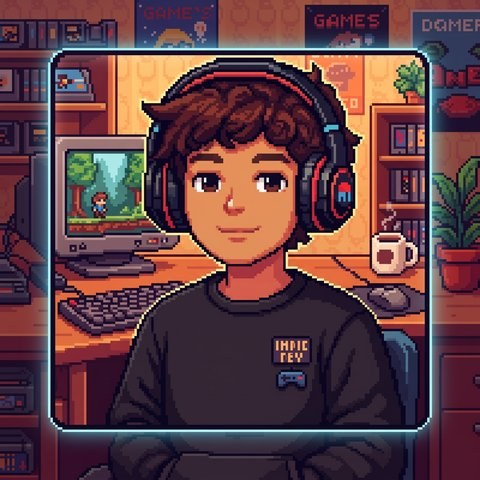{.avatar} |
| Mohamed Loai | 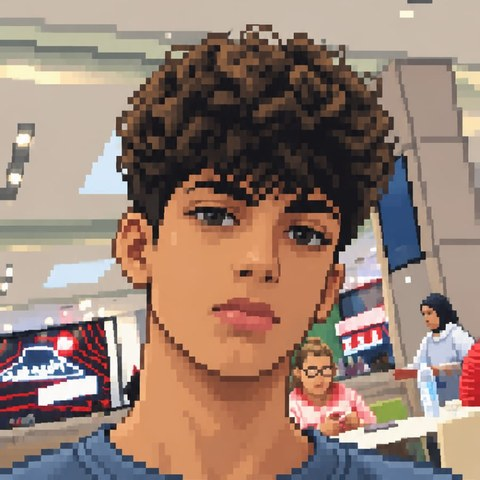{.avatar} |
| Medhat Ali | 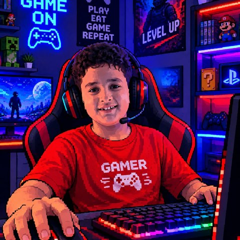{.avatar} |
| Salah Mohamed | 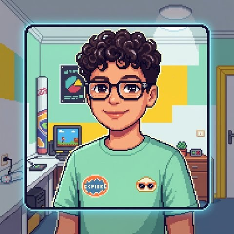{.avatar} |

#### What are your games about?

Crab Quest follows a crab from a kitchen counter, over a beach and the sea floor, past a predator, to a coral sanctuary where its family waits. Space X sends a Hero from a launch pad on Earth through orbit and the asteroid belt to Europa and Jupiter.

#### What makes the studio special?

Every fact in the games is real, and every fact appears at the moment it matters in the story. No fake features, no invented statistics.

### What We Learned

1. The hardest part of making our games was: ______________________________

2. The most fun part of making our games was: ______________________________

3. If we had more time, we would add: ______________________________

4. One thing we would do differently: ______________________________

### Screenshot of Our Project

See the screenshots in section 6.

---

**Instructor Notes**

Pixel Verse Studios shows that a small team can ship two complete educational games, with real facts and one clean architecture, using free tools.
