# Pixel Verse Studios: Game Technical Documentation

Technical documentation of Pixel Verse Studios (Crab Quest and Space X) for AFFIAT Aswan Finals 2026, Games category.

<p align="center">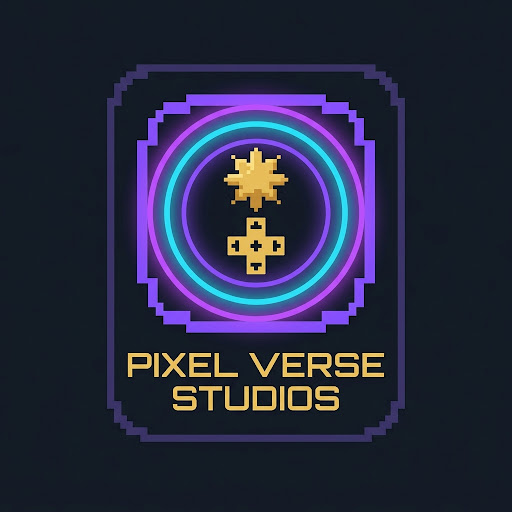</p>

<p align="center"></p>

## 1. Project Overview

| Field | Value |
|-------|-------|
| **Project Title** | Pixel Verse Studios: Crab Quest and Space X |
| **Project Type** | Two desktop games (Python) and a studio website |
| **Event** | AFFIAT · Afro-Asian Forum for Innovation and Technology · Aswan Finals 2026 · Games category |
| **Team** | Mariam Alaa, Selim Loai, Mohamed Loai, Medhat Ali, Salah Mohamed |
| **Description** | Pixel Verse Studios is a team of five that makes 16-bit games. Crab Quest follows a crab through six chapters from a kitchen to a coral sanctuary. Space X flies a Hero from a launch pad on Earth to Europa, Jupiter’s icy moon. |
| **Target Users** | Children and families (ages 5 to 99), and teachers who want science inside a game. |
| **Studio website** | <https://ibrhmahmd.github.io/PVS/> (needs GitHub Pages turned on for the repository) |

### The two games

| | Crab Quest | Space X: Journey to Jupiter |
|---|---|---|
| **Genre** | Platformer, survival and collection | Walk, dodge and shoot |
| **Structure** | 6 chapters chosen from a level-select screen | 4 levels in order, then a win screen |
| **Window** | 1200 × 600 | 800 × 600 |
| **Entry file** | `Crab-game/main.py` | `space-game/Game.py` |

### Tech Stack

| Category | Technology | Purpose |
|----------|-----------|---------|
| Language | Python 3.11+ | All the logic of both games |
| Engine | Pygame Zero (`pgzero` 1.2.1) on Pygame 2.6.1 | Window, `Actor` sprites, keyboard, mouse, music |
| Website | HTML, one CSS file (`assets/css/styles.css`), one small JavaScript file (`assets/js/site.js`) | The studio page for both games |
| Art | 16-bit pixel art | Backgrounds, sprites, planet pictures |
| Font | Jersey 10 (SIL Open Font License) | Pixel text inside Space X |
| Packaging | PyInstaller (Windows) and itch.io | Planned: tracked in each game's `ISSUES.md` |
| Source control | One Git repository (`PVS/`) for the website and both games | History of all three projects |

### Dependencies

| Package | Version | Purpose |
|---------|---------|---------|
| pgzero | 1.2.1 | The game engine (pinned in `space-game/requirements.txt`) |
| pygame | 2.6.1 | Comes with pgzero. Also used directly for fullscreen, sounds and loading pictures |
| random, os, sys | Standard library | Spawning, finding the game folder |

## 2. Problem Statement

Science facts are easy to forget when they are only read or heard. Children play many games, but few teach real science without breaking the fun.

### Why does it matter?

Facts that are not remembered are not used. A child who never connects ocean pollution or space exploration to anything real has less reason to care about them.

### How is it currently solved?

Children learn these facts from lessons, books and videos. Those explain well but do not let the child act. Many games let the child act but do not teach. Our games try to do both.

## 3. Technical Architecture

### Project Structure

```text
PVS/
├── Crab-game/                 Crab Quest (10 Python files)
│   ├── main.py                Only entry point: draw/update/input hooks that switch on the mode
│   ├── game_states.py         Shared state: game_mode, music on/off, game over, win
│   ├── start_screen.py        Title screen with the start button
│   ├── level_select.py        Six chapter buttons
│   ├── level_1.py ... level_6.py   One self-contained module per chapter
│   ├── images/  music/
├── space-game/                Space X: Journey to Jupiter (19 Python files)
│   ├── Game.py                Only the Pygame Zero hooks and start_level()
│   ├── screens/               title, fact_card, game_over, win
│   ├── levels/                launch_pad, earth_orbit, belt, europa
│   ├── parts/                 ship, controls, hud, game_states
│   ├── data/                  level_data.py (targets, story, facts), game_data.py (planet facts)
│   ├── images/  music/  fonts/
├── pixel-verse-studios/       Studio website: index, games, heros-journey, studio-lore
├── docs/                      This documentation, the poster, the slides and the diagrams
└── index.html                 Redirects the repository root to the website
```

### Architecture and Data Flow

```text
Keyboard / mouse
    -> Pygame Zero hooks in the main file: draw(), update(), on_key_down(), on_mouse_down()
        -> read the one mode variable (game_states.game_mode or parts/game_states.mode)
        -> hand the work to the module that owns that screen or level
            -> the module draws, moves things, checks hits and counts points
            -> when something ends it changes the mode (fact card, game over, next level)
```

There are no classes in either game. Each module can be read on its own, top to bottom.

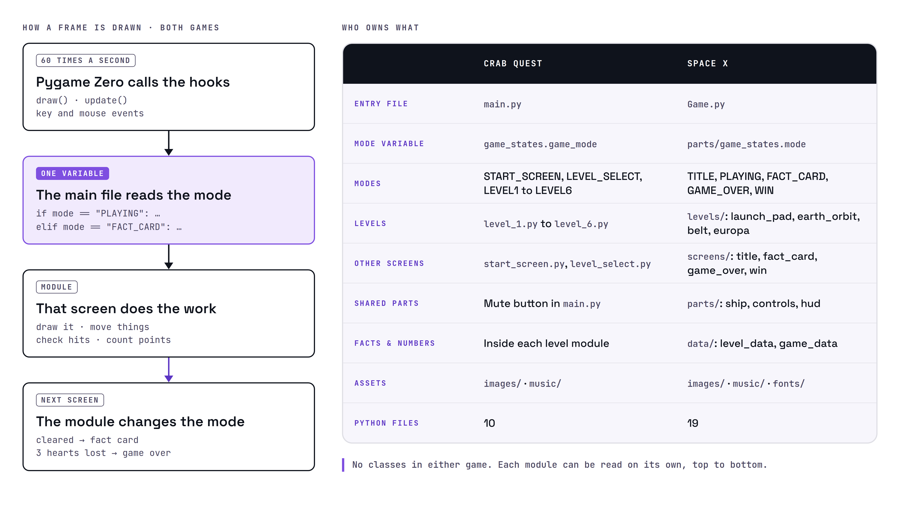

### Key Files

| File | Purpose |
|------|---------|
| `Crab-game/main.py` | Draws and updates the screen named by `game_states.game_mode` and draws the mute button on top of every screen. |
| `Crab-game/level_4.py` | The longest chapter: the shrimp collects 17 algae on 23 platforms before a 60-second timer ends. |
| `space-game/Game.py` | Pygame Zero hooks, `start_level()`, music handling, and the mode changes `NEXT_LEVEL` and `RETRY_LEVEL`. |
| `space-game/parts/ship.py` | The Ship: moving, firing a football every half second, bullets and the crash and shoot sounds. |
| `space-game/levels/europa.py` | Ice chunks that take two hits (the first hit swaps to a cracked picture), then a 3-second scan. |
| `space-game/data/level_data.py` | One points target per level, plus each level's story line and science fact. |
| `space-game/data/game_data.py` | The nine planet facts shown at game over: a picture and lines of text each. |
| `pixel-verse-studios/scripts/check_site.py` | The website's acceptance check. |

## 4. Features & User Flow

### Feature List

| # | Feature | Description | Status |
|---|---------|-------------|:------:|
| 1 | Six Crab Quest chapters | Platforming, dodging, collecting and surviving, with a level-select screen. | Complete |
| 2 | Mute button | Music on or off from any Crab Quest screen. | Complete |
| 3 | Launch pad level | Walk the Hero, pick up 4 checklist items, board before a 30-second countdown ends. | Complete |
| 4 | Earth orbit | Dodge space junk; the Ship cannot shoot here. | Complete |
| 5 | Asteroid belt | The Ship fires on its own every half second; Space adds extra shots. | Complete |
| 6 | Europa | Break two-hit ice chunks, then a 3-second scan. | Complete |
| 7 | Fact card | After every level: a story line and a science fact. | Complete |
| 8 | Game over facts | A random picture and fact from the Sun and eight planets. | Complete |
| 9 | Controls | Keyboard, plus clickable left, right, pause and continue buttons in Space X. | Complete |
| 10 | Windows download and itch.io page | Not published yet. | In progress |

### Controls

| Input | Crab Quest | Space X |
|-------|-----------|---------|
| ← → (or A D) | Move | Walk the Hero or move the Ship |
| SPACE | Jump | Start, continue, and shoot (the Ship also fires by itself in the belt and on Europa) |
| P | | Pause |
| R | Restart the level | Retry the level after game over, or fly again after the win |
| ENTER | Back to level select after a win | |
| ESC | Leave a chapter (back to level select), or leave level select (back to start) | |
| F | | Fullscreen |
| Mouse | Start, pick a chapter, mute | Continue on menus; on-screen left, right and pause buttons |

### User Flow

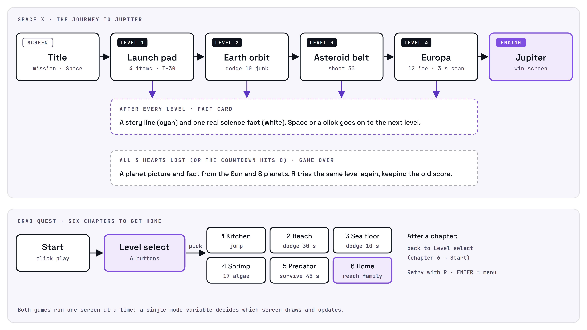

```text
Crab Quest:  Start -> Level select -> chapter 1-6 -> back to Level select (chapter 6 -> Start)

Space X:     Title -> L1 Launch pad -> Fact card -> L2 Earth orbit -> Fact card
             -> L3 Asteroid belt -> Fact card -> L4 Europa -> Fact card -> Win (Jupiter) -> Title
             Lose all 3 hearts (or the countdown ends) -> Game over -> R: same level again
```

### Screen Reference

| Screen | File | Description |
|--------|------|-------------|
| Start | `Crab-game/start_screen.py` | Logo, swimming fish, start button. |
| Level select | `Crab-game/level_select.py` | Six chapter buttons. |
| Chapters 1–6 | `Crab-game/level_1.py` … `level_6.py` | Kitchen Escape, Beach Run, Sea Floor Dodging, Shrimp Help, Predator Chase, Home Sweet Home. |
| Title | `space-game/screens/title.py` | Logo, the Hero, the mission text, the high score. |
| Launch pad | `space-game/levels/launch_pad.py` | Walk, collect four items, countdown, boarding and blast-off. |
| Earth orbit | `space-game/levels/earth_orbit.py` | Dodge 10 pieces of junk. |
| Asteroid belt | `space-game/levels/belt.py` | Shoot 30 asteroids. |
| Europa | `space-game/levels/europa.py` | Break 12 ice chunks, then scan. |
| Fact card | `space-game/screens/fact_card.py` | Story line (cyan), fact (white), "Press Space to continue". |
| Game over | `space-game/screens/game_over.py` | Planet picture and fact; R tries the level again. |
| Win | `space-game/screens/win.py` | Jupiter, the mission result, score and high score. |

## 5. UI/UX Design

### Screenshots

| Space X: title | Space X: launch pad |
|----------------|---------------------|
| 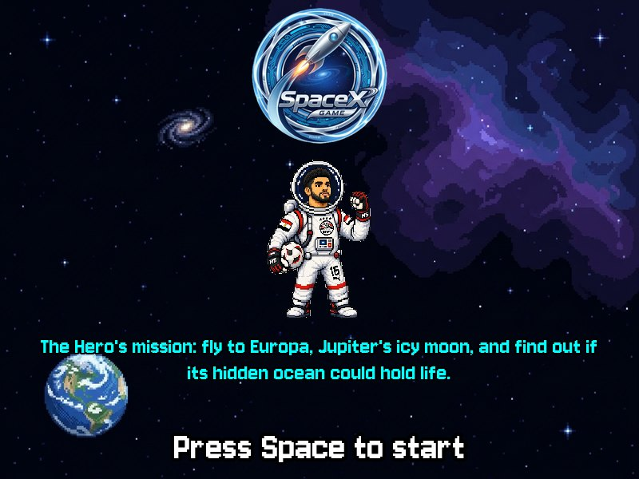 | 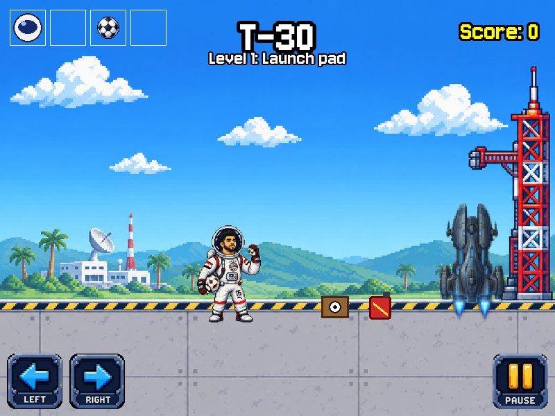 |

| Space X: Earth orbit | Space X: asteroid belt |
|----------------------|------------------------|
| 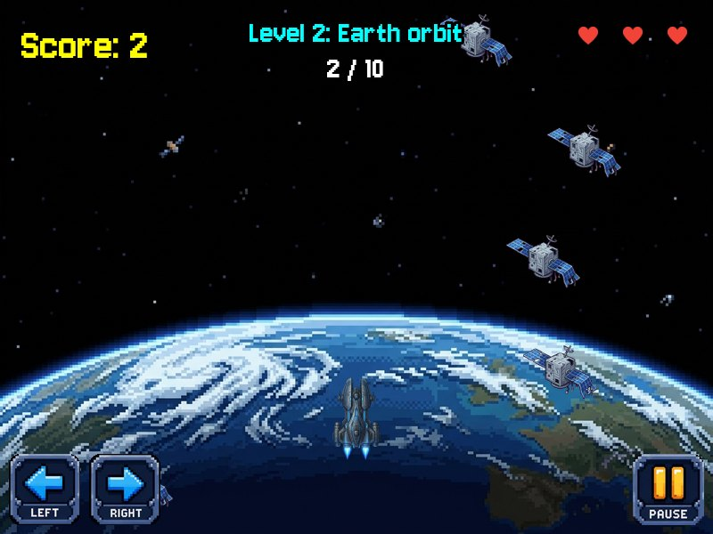 | 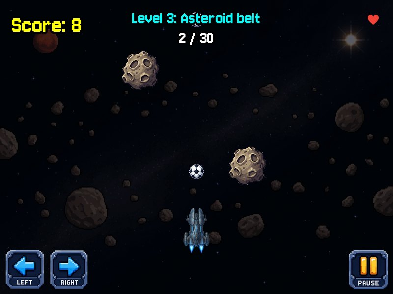 |

| Space X: Europa | Space X: win screen |
|-----------------|---------------------|
| 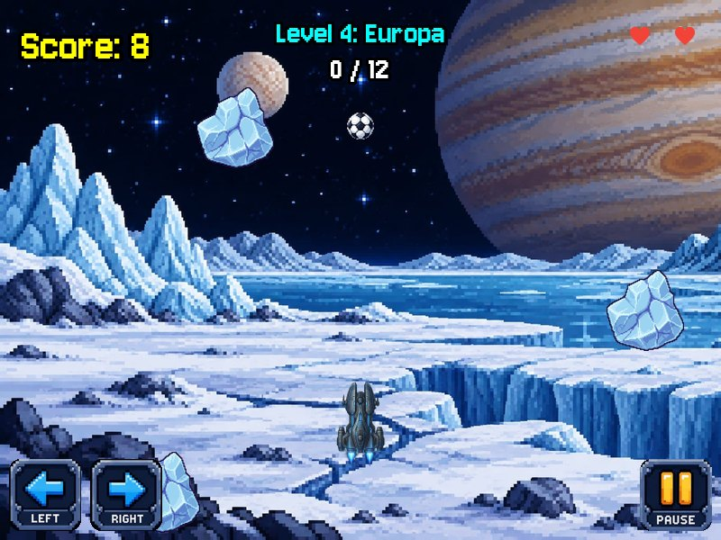 | 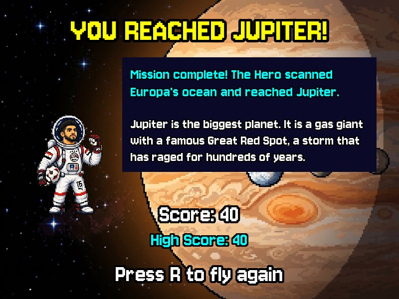 |

| Space X: fact card | Space X: game over |
|--------------------|--------------------|
| 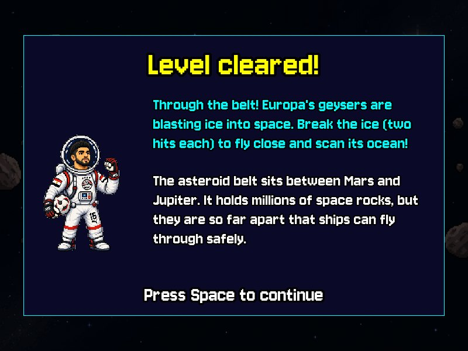 | 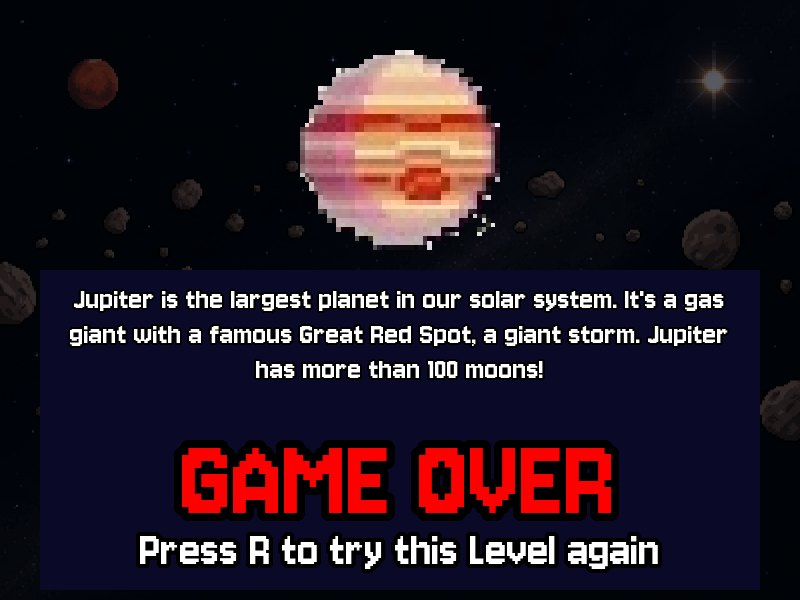 |

| Crab Quest: start | Crab Quest 1: Kitchen Escape |
|-------------------|------------------------------|
| 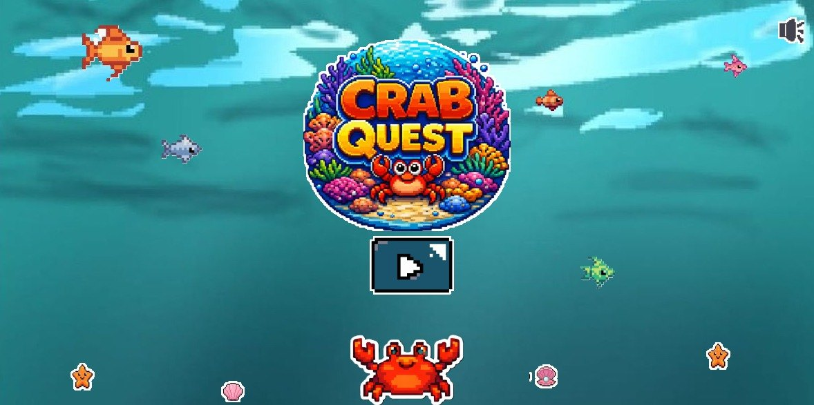 | 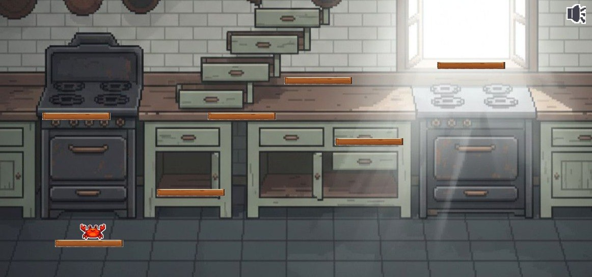 |

| Crab Quest 2: Beach Run | Crab Quest 3: Sea Floor Dodging |
|-------------------------|---------------------------------|
| 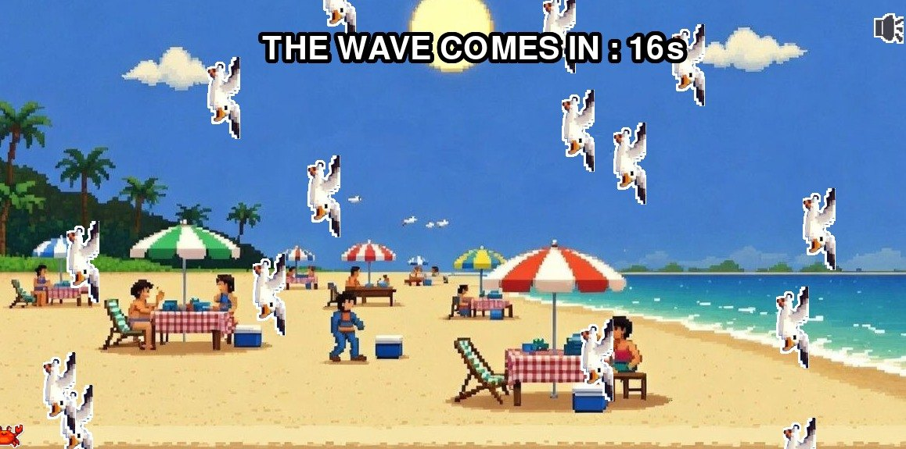 | 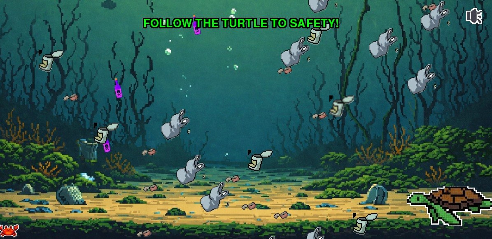 |

| Crab Quest 4: Shrimp Help | Crab Quest 5: Predator Chase |
|---------------------------|------------------------------|
| 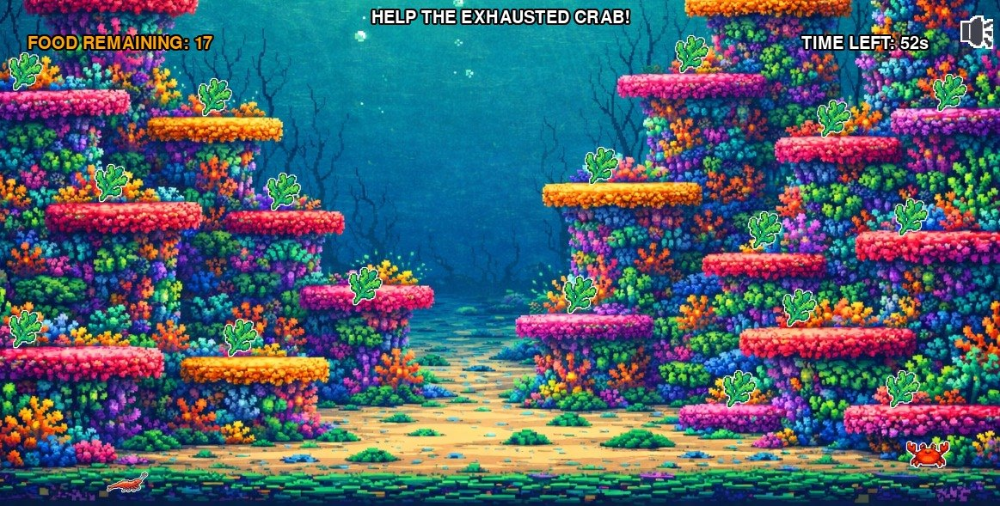 | 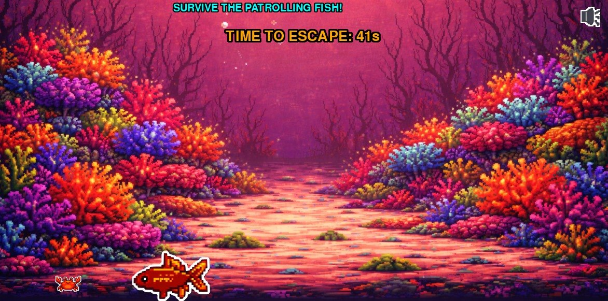 |

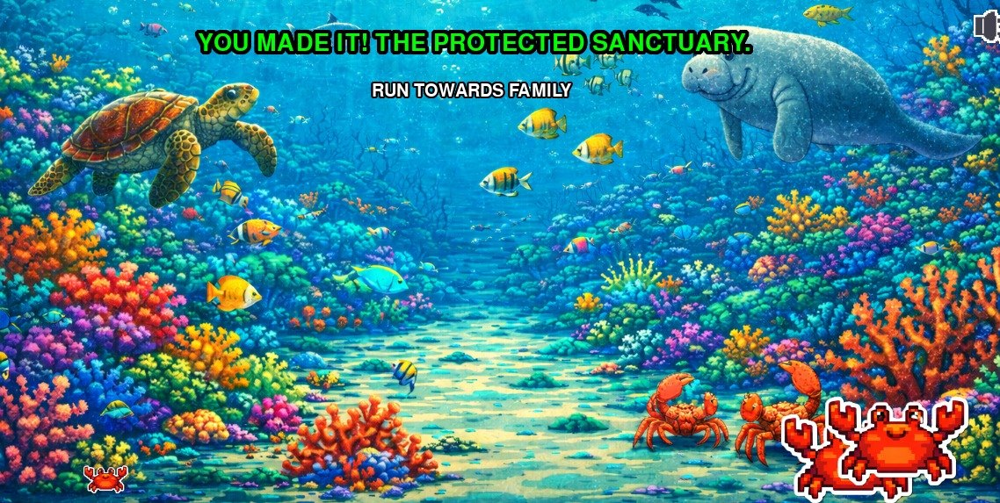

Visit the studio: <https://ibrhmahmd.github.io/PVS/>


### Design System

| Element | Current implementation |
|---------|------------------------|
| Logo | A dark pixel frame with a purple ring, a cyan ring, a gold star and a gold d-pad, above "Pixel Verse Studios" in gold pixel letters. |
| Colours | Website: page `#0f131c`, purple `#d0bcff`, cyan `#4cd7f6`, green `#4edea3`. Poster and slides use a darker purple `#7E4FE0` and the logo gold `#E8BC59` so they read on light paper. |
| Fonts | Website: Space Grotesk (headings) and Inter (text). Space X: Jersey 10, a pixel font, for all in-game text. Poster and slides: Jersey 10, Space Grotesk and JetBrains Mono. |
| Art | 16-bit pixel art, hard-edged pixels, dark outlines, light from the upper left. |
| Buttons | Website: square corners with a hard offset shadow. Space X: pixel arrow and pause buttons. Crab Quest: a pixel start button and mute icon. |
| Layout | Games: one fixed window each (1200 × 600 and 800 × 600). Website: full-width sections and cards. |

## 6. Data Sources

### Data Sources

| Source | Type | Description |
|--------|------|-------------|
| `space-game/data/level_data.py` | Python list | For each of the 4 levels: name, background, points target, story lines and fact. Also the title mission and the win text. |
| `space-game/data/game_data.py` | Python list | 9 planet entries (the Sun and eight planets): picture path and the lines of the fact. |
| Level modules in `Crab-game/` | Python values | Platform positions, speeds, timers and spawn rates for each chapter. |
| `images/`, `music/`, `fonts/` | Local files | Pictures, background music, sound effects and the pixel font. |
| Players | Keyboard and mouse | The only input. Nothing is saved. |

### Database Schema

None. The games and the website use no database. Everything the games need is in Python lists and local files.

### External APIs

| API | Purpose | Rate Limit |
|-----|---------|------------|
| None | The games run offline. The website loads its fonts from Google Fonts. | Not applicable |


## 7. Educational Content

### Learning Objectives

Through playing and building these games, a student can practice:

1. That ocean animals face real threats (predators, trash, lost homes) and that protected reefs help, and that Europa hides a salty ocean under its ice.
2. How a game loop works in Pygame Zero: draw, update and input events.
3. How one mode variable moves a game between screens, so every screen can be its own small module.
4. How collisions, timers, spawn rates and points targets make a level fair.
5. How to keep facts and level numbers in plain Python lists instead of burying them in the code.

### Cultural / Historical Context

| Topic | Description |
|-------|-------------|
| Ocean conservation | Crab Quest takes a crab past birds, trash and a predator fish to a protected sanctuary. |
| Space exploration | Space X’s mission is to find out whether Europa’s hidden ocean could hold life. Its fact cards teach about orbit junk, the asteroid belt and Europa. |
| Learning through games | Facts appear where the story needs them: after a level, or when the player loses. |

### Curriculum Alignment

| Skill Area | What the Student Practices |
|------------|---------------------------|
| Problem Solving | Planning a route through a level, and debugging collisions and timers. |
| Computational Thinking | State machines, spawn timers and points targets. |
| Creativity | Pixel art, level layouts and story lines. |
| Collaboration | Five people sharing one repository, with an issue list for each project. |
| Technical Writing | Writing the issues, README files and this documentation. |

## 8. Marketing Plan

### Target Audience

- **Primary:** Children and families who like short pixel-art games.
- **Secondary:** Teachers who want a science game for a classroom or computer lab.

### Platforms

- Windows desktop (a PyInstaller build is planned) and the source code, which runs on any computer with Python
- Show it at AFFIAT Aswan Finals 2026, then publish both games on itch.io and link the studio website.

## 9. Student Worksheet

### Our Project Information

**Team:**

| Member | Portrait |
|--------|----------|
| Mariam Alaa |  |
| Selim Loai |  |
| Mohamed Loai |  |
| Medhat Ali |  |
| Salah Mohamed |  |

---